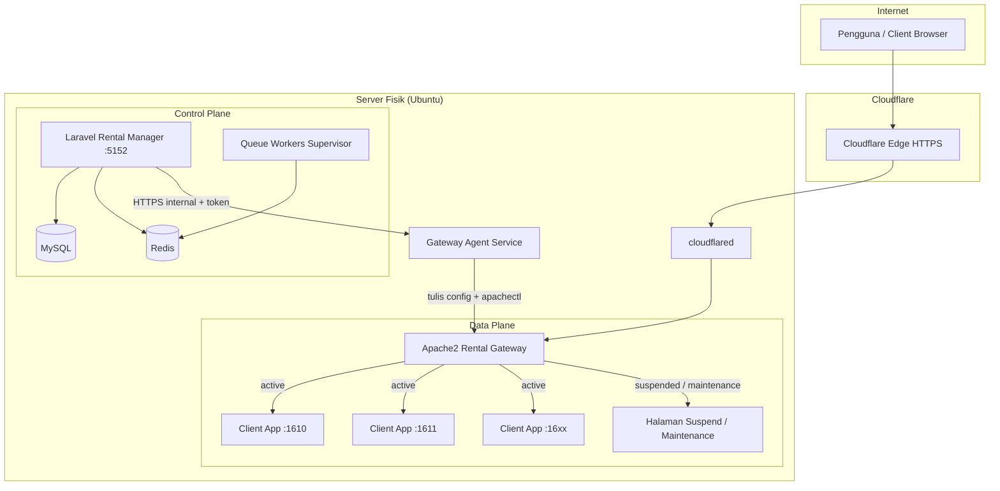
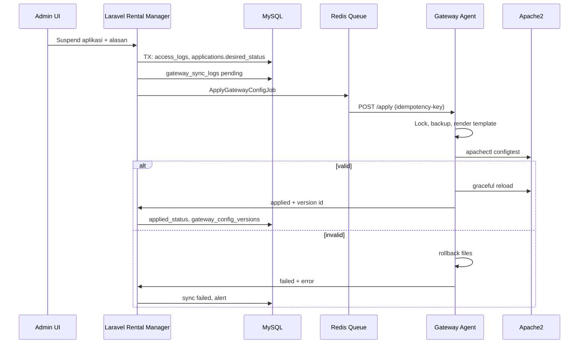
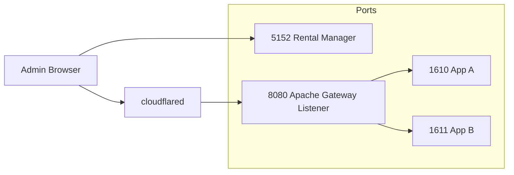

# 02 — Arsitektur Sistem

## 1. Pemisahan Control Plane vs Data Plane



## 2. Alur perubahan status akses



## 3. Komponen utama

| Komponen | Teknologi | Catatan |
|----------|-----------|---------|
| Rental Manager | Laravel 11.x (target), PHP 8.2+ | Modular monolith |
| Gateway | Apache 2.4 | Virtual host per hostname |
| Agent | Go atau Python (systemd) | Bukan di dalam request path publik |
| Queue | Redis + Supervisor | Apply gateway async |
| Edge | cloudflared | Hostname → `http://127.0.0.1:<gateway-port>` |

## 4. Model status (dua lapisan)

| Lapisan | Field konsep | Makna |
|---------|--------------|-------|
| Desired | `applications.access_status` | Keputusan bisnis admin/sistem |
| Applied | `applications.gateway_applied_status` | Keadaan di Apache setelah sync sukses |
| Sync | `gateway_sync_logs.status` | pending / applied / failed |

Kebijakan subscription (`subscription_status`, `invoice_status`) **tidak** langsung menjadi file Apache; service layer memetakan ke `access_status` sesuai aturan.

## 5. Struktur konfigurasi Apache (konseptual)

```
/etc/apache2/rental-gateway/
├── apps/                    # Include per aplikasi (generated)
│   └── app-{uuid}.conf
├── status/                  # Snippet mode: proxy vs static
├── static/
│   ├── suspend/
│   └── maintenance/
├── templates/               # Hanya dibaca Agent (immutable deploy)
├── backups/                 # Timestamp per apply
├── manifest.json            # Versi terakhir terapply (optional)
└── rental-gateway.conf      # Include utama (manual once)
```

Apache `IncludeOptional /etc/apache2/rental-gateway/apps/*.conf`

## 6. Routing hostname

- Satu `ServerName` / `ServerAlias` per kombinasi hostname unik.
- `ProxyPass / http://127.0.0.1:PORT/` hanya jika mode **active**.
- Mode **suspended**: `DocumentRoot` atau `Alias` ke static + `Require all granted` + header no-cache.
- WebSocket: `mod_proxy_wstunnel` + `ProxyPass /ws ws://127.0.0.1:PORT/ws` (path disesuaikan per app) — **hanya saat active**.

## 7. Skalabilitas ke multi-node (future)

Tanpa redesign total:

- `gateway_nodes` table + `applications.gateway_node_id`
- Agent per node dengan token unik
- Rental Manager dispatch job ke node yang benar
- Manifest & DNS/tunnel per node

MVP: satu node, `gateway_node_id` nullable/default.

## 8. Diagram deployment logis



**Rekomendasi:** Tunnel hanya ke port gateway Apache (mis. 8080), **bukan** ke port 5152 kecuali dengan Access policy ketat.

## 9. Integrasi modul Laravel (ringkas)

```
app/
├── Domain/
│   ├── Clients/
│   ├── Applications/
│   ├── Subscriptions/
│   ├── Billing/
│   └── Gateway/
├── Http/Controllers/
├── Policies/
├── Services/          # AccessControlService, GatewaySyncService, InvoiceService
├── Jobs/              # ApplyGatewayConfigJob, ReconcileGatewayJob
└── Events/Listeners/  # PaymentVerified → maybe ActivateApplication
```

Lihat [08-api-specification.md](08-api-specification.md) untuk kontrak Agent.
