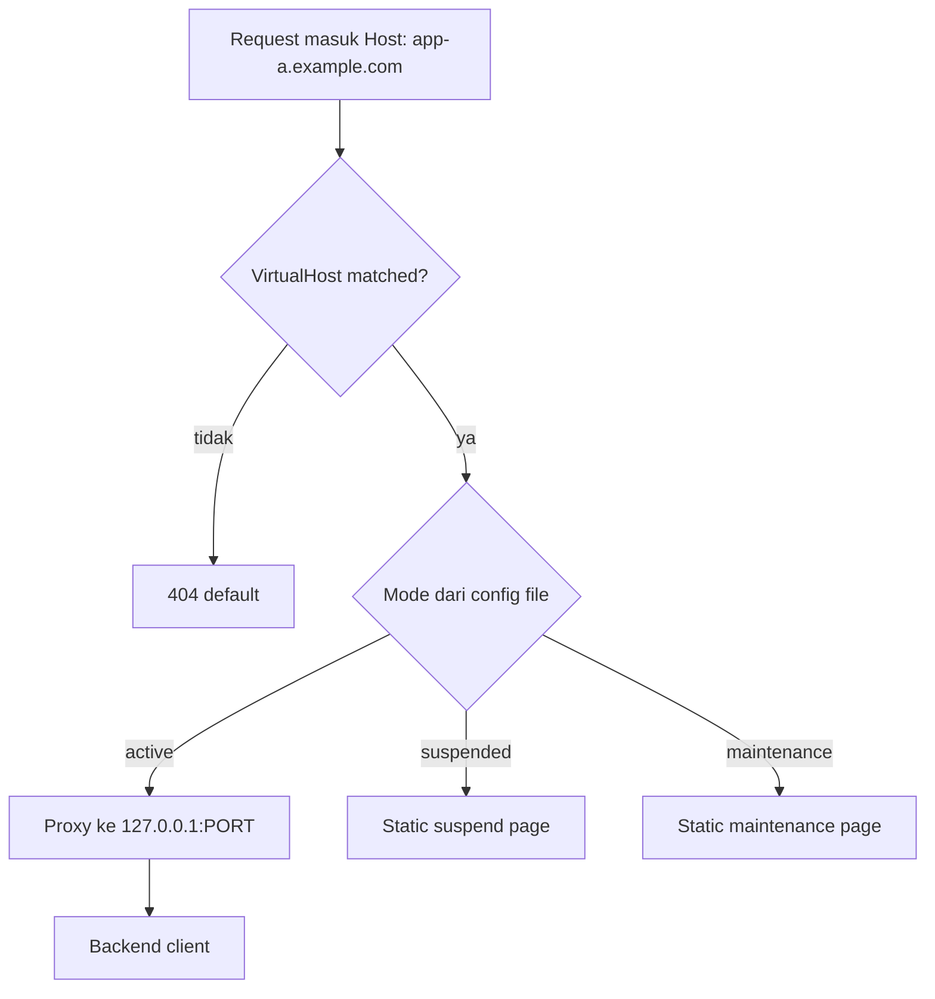

# 04 — Apache2 sebagai Central Gateway

## 1. Tujuan

Menerima traffic dari cloudflared, memilih backend berdasarkan **Host**, menerapkan **access mode** tanpa memanggil Laravel/MySQL.

## 2. Modul Apache (checklist)

| Modul | Fungsi | Audit server (read-only) |
|-------|--------|---------------------------|
| mod_proxy | Reverse proxy | **loaded** |
| mod_proxy_http | HTTP backend | **loaded** |
| mod_rewrite | Routing helper | **loaded** |
| mod_ssl | TLS lokal (opsional) | **loaded** |
| mod_headers | Cache-Control suspend | **belum loaded** — wajib enable |
| mod_proxy_wstunnel | WebSocket | **belum loaded** — enable jika app pakai WS |
| mod_alias | Static suspend pages | biasanya via alias_module (**loaded**) |
| mod_authz_core | Authorization | **loaded** |

**Tindakan future (butuh persetujuan):** `a2enmod headers proxy_wstunnel` lalu reload.

## 3. Listener gateway

Rekomendasi: VirtualHost dedikasi `127.0.0.1:8080` (atau port yang disepakati) sebagai **satu entry** dari cloudflared.

Rental Manager (5152) **terpisah** — tidak mix dengan vhost client di file yang sama.

## 4. Pola konfigurasi per aplikasi

Tiga template (disimpan di `templates/`, dirender Agent):

### Mode `active`

```apache
# Konseptual — versi final disesuaikan apachectl -M
<VirtualHost *:8080>
    ServerName app-a.example.com
    ServerAlias www.app-a.example.com

    ProxyPreserveHost On
    RequestHeader set X-Forwarded-Proto "https"
    RequestHeader set X-Forwarded-For expr=%{REMOTE_ADDR}

    ProxyPass        / http://127.0.0.1:1610/ connectiontimeout=5 timeout=300
    ProxyPassReverse / http://127.0.0.1:1610/

    # WebSocket (jika enabled untuk app ini)
    # ProxyPass /ws ws://127.0.0.1:1610/ws
    # ProxyPassReverse /ws ws://127.0.0.1:1610/ws
</VirtualHost>
```

### Mode `suspended`

Tidak ada `ProxyPass` ke backend. Serve static:

```apache
<VirtualHost *:8080>
    ServerName app-a.example.com

    DocumentRoot /var/www/rental-gateway/static/suspend
    <Directory /var/www/rental-gateway/static/suspend>
        Require all granted
        Options -Indexes
    </Directory>

    Header always set Cache-Control "no-store, no-cache, must-revalidate, max-age=0"
    Header always set Pragma "no-cache"
    Header always set X-Rental-Gateway-Status "suspended"

    ErrorDocument 403 /index.html
    ErrorDocument 404 /index.html
</VirtualHost>
```

HTTP status: **503 Service Unavailable** (via `RedirectMatch` atau PHP/static handler) — dipilih saat implementasi; konsisten untuk SEO/monitoring.

### Mode `maintenance`

Sama struktur, `DocumentRoot` → `static/maintenance`, header `X-Rental-Gateway-Status: maintenance`.

## 5. Mekanisme suspend — alur request



Tidak ada include `RewriteRule` ke endpoint Laravel.

## 6. WebSocket saat suspend

| Situasi | Perilaku |
|---------|----------|
| Request WS **baru** saat suspended | VirtualHost tanpa ProxyPass WS → handshake gagal / 503 |
| Koneksi WS **sudah terbuka** sebelum suspend | Tetap hidup sampai client/server putus; **graceful reload tidak garanti putus instan** |
| Kebijakan operasi | Umumkan maintenance; optional tunggu N menit; atau restart Apache (downtime) — **butuh persetujuan** |

Mitigasi soft: backend client bisa memutus WS sendiri; gateway hard block hanya untuk koneksi baru.

## 7. Perlindungan path & API

Saat suspended, **seluruh path** (`/`, `/api/*`, assets) dilayani static — tidak proxy sebagian path.

## 8. Validasi backend host/port

Gateway Agent **hanya** render host dari whitelist (`127.0.0.1`, `localhost`) dan port dalam range `[1024–65535]` yang terdaftar di DB.

## 9. Pencegahan bypass

| Vektor | Mitigasi |
|--------|----------|
| Akses langsung `:1610` dari internet | Firewall; bind backend ke localhost |
| Host header spoof internal | Apache `ServerName` match; cloudflared set host asli |
| Path traversal di Agent | Template fixed; tidak concat path user |

## 10. Operasi reload

1. `apachectl configtest`
2. `apache2ctl graceful` (bukan restart penuh kecuali emergency)

Log Agent mencatat stdout/stderr configtest.

## 11. Halaman static

- `/var/www/rental-gateway/static/suspend/index.html`
- `/var/www/rental-gateway/static/maintenance/index.html`

Kustomisasi terpusat: Agent deploy asset dari paket versi; optional `branding.json` (logo URL, warna) **tanpa** data sensitif client.

Pesan wajib (Indonesia):

- **Suspend:** "Layanan Sementara Ditangguhkan"
- **Maintenance:** "Sedang Dalam Pemeliharaan"

## 12. Uji konfigurasi (otomasi)

- Script CI: render template dengan fixture → `apachectl -t -f` di container Apache 2.4
- Skenario: active, suspended, maintenance, invalid port

Lihat [09-testing-strategy.md](09-testing-strategy.md).
