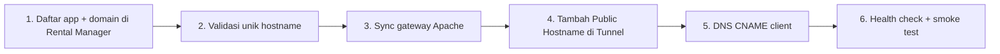

# 05 — Cloudflare Tunnel

## 1. Alur traffic

```
Internet → Cloudflare (TLS) → cloudflared (di server) → http://127.0.0.1:8080 (Apache Gateway) → backend port
```

Audit read-only: **cloudflared 2026.3.0**, service **active**.

## 2. Dua pendekatan hostname

### Pendekatan A — Public Hostname per aplikasi (MVP ** direkomendasikan**)

| Aspek | Keterangan |
|-------|------------|
| Cara kerja | Setiap `app.client.com` → route ke `http://127.0.0.1:8080` di Cloudflare Zero Trust / Tunnel config |
| DNS | CNAME ke `<tunnel-id>.cfargotunnel.com` atau record proxied |
| Kelebihan | Sederhana, eksplisit, mudah audit, tidak bergantung wildcard |
| Kekurangan | Manual/API per hostname; skala ratusan perlu otomasi (fase lanjutan) |
| MVP | Tambah hostname di dashboard + dokumentasi onboarding |

### Pendekatan B — Wildcard hostname

| Aspek | Keterangan |
|-------|------------|
| Cara kerja | `*.rental.example.com` → satu tunnel → Apache routing by Host |
| Syarat | Zone DNS di Cloudflare; wildcard tunnel + sertifikat edge Cloudflare |
| Kelebihan | Onboarding subdomain cepat tanpa edit tunnel per app |
| Kekurangan | **Custom domain client** tetap perlu hostname terpisah; wildcard tidak menggantikan domain pihak ketiga |
| Risiko | Salah DNS bisa expose subdomain tidak terdaftar → Apache default vhost |

**Keputusan MVP:** Pendekatan A + Apache `ServerName` per app. Wildcard hanya jika zone induk dikonfirmasi milik penyedia dan policy default vhost aman (return 444/403).

## 3. HTTPS publik

TLS di terminasi Cloudflare. Origin tunnel → Apache biasanya **HTTP localhost** (recommended behind tunnel).

Header `X-Forwarded-Proto: https` diset Apache untuk backend jika app butuh URL scheme.

## 4. WebSocket

Cloudflare Tunnel mendukung WS. Apache perlu `mod_proxy_wstunnel`. Path WS harus konsisten dengan app client.

## 5. Onboarding domain baru (prosedur)



Checklist dokumen operasi: [11-operations-runbook.md](11-operations-runbook.md).

## 6. Integrasi Cloudflare API (fase lanjutan)

| Fitur API | Manfaat |
|-----------|---------|
| Create tunnel route | Kurangi manual dashboard |
| DNS CNAME automation | Hanya untuk zone yang kita kontrol |

**Bukan** dependency MVP. Token disimpan di env/vault, rotasi berkala.

## 7. Cache & halaman suspend

Set di Apache:

- `Cache-Control: no-store`
- Cloudflare Page Rule / Cache Rule: bypass cache untuk hostname app **opsional** (defense in depth)

Jangan cache 503 suspend di edge.

## 8. Admin dashboard Rental Manager

**Tidak** wajib publik via tunnel yang sama. Opsi:

- Subdomain admin terpisah + Cloudflare Access
- VPN / IP allowlist
- Port 5152 hanya localhost + SSH tunnel

Klarifikasi keamanan admin: lihat [06-security-design.md](06-security-design.md).

## 9. Risiko & mitigasi

| Risiko | Mitigasi |
|--------|----------|
| Tunnel down | Monitoring cloudflared; alert |
| Hostname lupa ditambah di tunnel | Checklist onboarding; status "DNS pending" di app |
| SSL mode salah | Full (strict) jika origin punya sert; HTTP localhost OK dengan tunnel |

## 10. Yang tidak dilakukan tanpa persetujuan

- Edit `/etc/cloudflared/config.yml` produksi
- Restart `cloudflared`
- Hapus route tunnel existing
