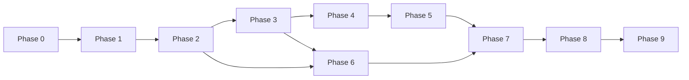

# 07 — Roadmap Pengembangan (Phase 0–9)

Setiap fase memiliki: **Tujuan, Scope, Pekerjaan, Dependensi, Deliverables, Acceptance Criteria, Risiko, Status**.

---

## Phase 0 — Discovery & Infrastructure Audit

| | |
|---|---|
| **Tujuan** | Memahami baseline server dan gap terhadap stack target |
| **Scope** | Read-only audit; dokumentasi; tidak ubah produksi |
| **Status** | **IN PROGRESS** (audit awal selesai; klarifikasi user pending) |

### Pekerjaan

- [x] Cek versi PHP, Apache, MariaDB, cloudflared, Redis, modul Apache
- [ ] Inventaris vhost & tunnel route existing (butuh akses baca config)
- [ ] Inventaris port aplikasi client yang sudah jalan
- [ ] Checklist upgrade PHP 8.2+ / MariaDB (rencana, belum eksekusi)
- [ ] Klarifikasi pertanyaan di [01-requirements.md](01-requirements.md) §4

### Dependensi

- Akses SSH read-only dokumentasi config

### Deliverables

- Laporan audit di README + [12-decision-log.md](12-decision-log.md)
- Checklist kompatibilitas di [10-deployment-guide.md](10-deployment-guide.md)

### Acceptance criteria

- Semua komponen MVP teridentifikasi gap-nya
- Risiko upgrade terdokumentasi dengan rekomendasi

### Risiko

- Temuan PHP 7.4 memblokir Laravel 11 → rencana upgrade wajib

---

## Phase 1 — Architecture & Database Design

| | |
|---|---|
| **Tujuan** | Blueprint implementasi disetujui stakeholder |
| **Scope** | Docs, ERD, kontrak Agent, TASKS.md |
| **Status** | **DONE** (dokumentasi awal; revisi setelah feedback) |

### Deliverables

- docs/00–12, TASKS.md, README, CHANGELOG, .env.example

### Acceptance criteria

- Diagram arsitektur & ERD reviewed
- Keputusan MVP tunnel (hostname per app) disetujui

---

## Phase 2 — Laravel Foundation

| | |
|---|---|
| **Tujuan** | Project skeleton production-ready |
| **Scope** | Install Laravel, auth, RBAC, layout dashboard, DB, queue, testing harness |
| **Status** | **TODO** (menunggu persetujuan + PHP 8.2) |

### Pekerjaan

- Composer create-project (PHP 8.2+)
- Fortify/Breeze + Spatie Permission
- Layout admin (Bahasa Indonesia)
- Migration users/roles only + seed Super Admin
- Redis queue + Supervisor template
- PHPUnit baseline + CI config

### Dependensi

- Phase 1 approved
- Runtime PHP 8.2 available

### Acceptance criteria

- Login RBAC works; Viewer cannot mutate
- `php artisan test` green
- Queue worker documented

### Risiko

- PHP version mismatch on server

---

## Phase 3 — Client & Application Management

| | |
|---|---|
| **Tujuan** | CRUD client & aplikasi dengan validasi domain/port |
| **Scope** | Models, migrations full apps/clients/domains, UI, policies |
| **Status** | **TODO** |

### Acceptance criteria

- Duplicate hostname/port rejected
- Dashboard menampilkan counts dasar

---

## Phase 4 — Apache Gateway Integration

| | |
|---|---|
| **Tujuan** | Data plane routing + Agent |
| **Scope** | Template Apache, static pages, Agent service, staging vhost |
| **Status** | **TODO** |

### Pekerjaan

- Struktur `/etc/apache2/rental-gateway/` (staging dulu)
- Enable mod_headers (+ wstunnel if needed) **dengan persetujuan**
- Implement Gateway Agent v1
- Laravel GatewaySyncService + job

### Dependensi

- Persetujuan perubahan Apache staging

### Acceptance criteria

- Satu app dummy active/suspended via dashboard (staging)
- configtest + rollback verified

### Risiko

- Downtime jika salah include Apache — mitigasi staging

---

## Phase 5 — Suspend & Activation

| | |
|---|---|
| **Tujuan** | Lifecycle status + audit + retry |
| **Scope** | access_logs, sync logs, UI indicators pending/applied/failed |
| **Status** | **TODO** |

### Acceptance criteria

- Skenario wajib 1–6 terpenuhi di staging

---

## Phase 6 — Subscription & Billing

| | |
|---|---|
| **Tujuan** | Invoice & pembayaran manual |
| **Scope** | Plans, subscriptions, invoices, payments, verify → optional activate |
| **Status** | **TODO** |

### Acceptance criteria

- Partial payment; duplicate ref blocked; finance audit trail

---

## Phase 7 — Monitoring & Reporting

| | |
|---|---|
| **Tujuan** | Observability operasional |
| **Scope** | Health checks, service status, export laporan |
| **Status** | **TODO** |

### Acceptance criteria

- Dashboard gateway health; backend down detected

---

## Phase 8 — Security & Quality Assurance

| | |
|---|---|
| **Tujuan** | Hardening & test coverage |
| **Scope** | Security review, concurrency, Cloudflare Access admin (optional) |
| **Status** | **TODO** |

### Acceptance criteria

- Checklist [06-security-design.md](06-security-design.md) lulus review

---

## Phase 9 — Staging & Production Deployment

| | |
|---|---|
| **Tujuan** | Go-live terkontrol |
| **Scope** | Migration, backup, runbook, monitoring alert |
| **Status** | **TODO** |

### Acceptance criteria

- Rollback procedure tested
- Production checklist signed

### Risiko

- Upgrade PHP/MySQL production — maintenance window

---

## Urutan dependensi antar fase

Phase 6 dapat paralel sebagian dengan Phase 4–5 setelah Phase 3 selesai.
